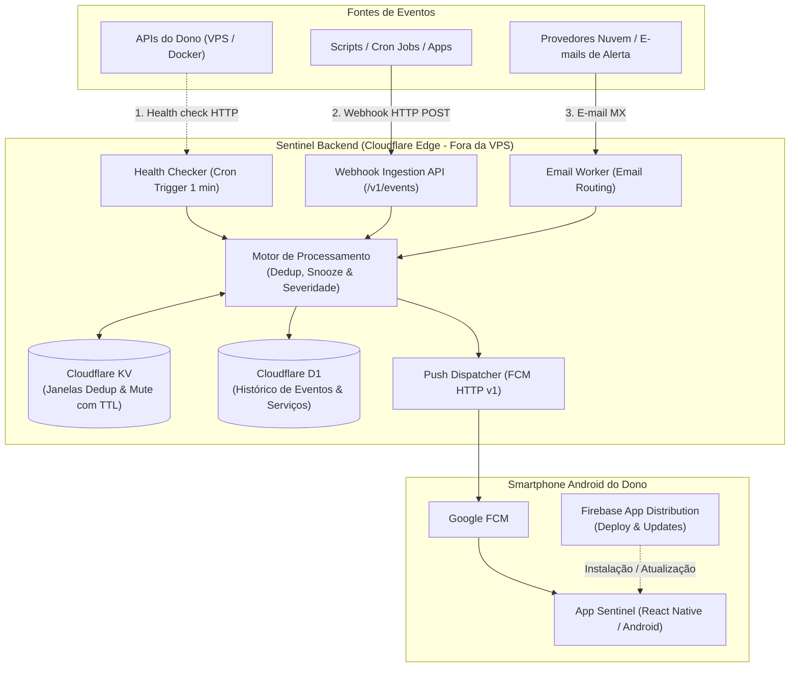
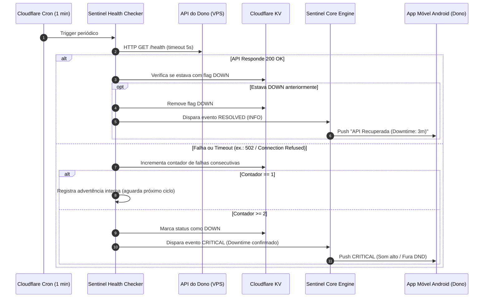
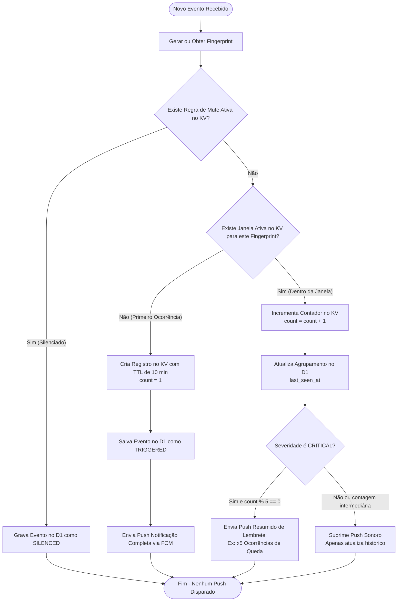
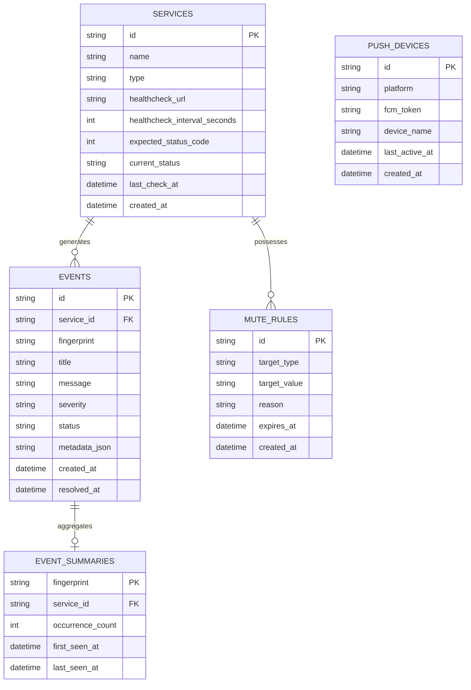

# Sentinel — Arquitetura de Sistema

Este documento detalha a arquitetura técnica proposta para o **Sentinel**, cobrindo o ciclo completo de ingestão de eventos, monitoramento externo, motor de deduplicação e entrega de notificações push em tempo real no smartphone **Android** do proprietário.

*(Nota de escopo: Suporte a ecossistema Apple iOS e APNs está expressamente fora de escopo por ora).*

---

## 1. Topologia Geral e Hospedagem Externa

Para eliminar o risco de ponto único de falha (*single point of failure*), nenhum componente crítico do Sentinel residirá na mesma infraestrutura que está sendo monitorada (VPSs ou servidores locais do dono).

A solução adota a **Cloudflare Developer Platform** (Serverless Edge) para o backend e monitoramento, complementada pelo **Firebase Cloud Messaging (FCM)** para despacho de notificações push ao aplicativo **React Native (Android)**:

- **Cloudflare Workers (Edge Serverless):** Execução distribuída globalmente com latência mínima e disponibilidade superior a 99.99%.
- **Cloudflare Cron Triggers:** Disparo periódico a cada 1 minuto para o motor de health check ativo.
- **Cloudflare Email Routing + Email Workers:** Interceptação programática de e-mails recebidos em domínio próprio sem necessidade de servidor SMTP.
- **Cloudflare D1 (SQLite Distribuído) & Cloudflare KV:** Armazenamento relacional de eventos/serviços e armazenamento chave-valor de alta velocidade com expiração automática (TTL) para deduplicação e regras de silenciamento (*snooze*).
- **Firebase Cloud Messaging (HTTP v1 API):** Entrega gratuita e direta de mensagens push para o aparelho Android do dono.
- **Firebase App Distribution:** Canal oficial de compilação, distribuição e atualização contínua do aplicativo Android (`.apk` / `.aab`) para o aparelho do proprietário.
- **React Native App (Android):** Cliente móvel para visualização de histórico, controle de status e recepção dos alertas com prioridade de sistema e canais com override de Não Perturbe (DND).



---

## 2. Ingestão de Eventos

O Sentinel conta com três portas de entrada complementares:

### 2.1. Ingestão Passiva via Webhook HTTP (`POST /v1/events`)
Aplicações e microsserviços do dono enviam exceções ou alertas através de requisição HTTP direta:
- **Autenticação:** Header `X-Sentinel-Key: <service_secret>` ou `Authorization: Bearer <service_secret>`.
- **Formato:** JSON estruturado contendo serviço de origem, título, mensagem, severidade e metadados opcionais.

### 2.2. Ingestão de E-mails via Cloudflare Email Routing
Alertas de fornecedores de nuvem (limites de cota AWS/GCP, avisos do Supabase, relatórios automáticos de planilhas/Excel) são encaminhados para `alertas@dominio.com`:
- O **Cloudflare Email Routing** recebe a mensagem e aciona um **Email Worker** via gatilho `email(message, env, ctx)`.
- O worker realiza o parse dos cabeçalhos (`From`, `Subject`), valida a autenticidade do remetente (SPF/DKIM) e extrai o corpo do texto via biblioteca de MIME parser (ex.: `postal-mime`).
- Normaliza o conteúdo para o modelo de evento do Sentinel com severidade padrão (ex.: `WARNING` ou `ERROR` conforme palavras-chave no assunto) e envia para o motor de processamento.

### 2.3. Monitor Ativo (Health Check na Edge)
Executado a cada 1 minuto via **Cloudflare Cron Trigger**:
- Consulta a lista de serviços ativos cadastrados na tabela `services`.
- Realiza requisições HTTP `GET` ou `POST` para os endpoints monitorados com timeout configurável (padrão: 5 segundos).
- Avalia status retornado (`200 OK`), latência e correspondência de corpo (opcional).
- **Lógica de Falha Consecutiva:** Para evitar falsos positivos por soluços de rede, a severidade `CRITICAL` só é disparada após **2 falhas consecutivas** registradas no KV.
- **Auto-recuperação (Auto-resolve):** Ao detectar que um serviço previamente marcado como `DOWN` voltou a responder `200 OK`, gera automaticamente um evento com status `RESOLVED` e severidade `INFO`, informando o tempo total de inatividade.



---

## 3. Modelo de Evento e Severidades

### 3.1. Níveis de Severidade e Comportamento no Android

| Severidade | Canal Android | Comportamento no Sistema Operacional | Casos de Uso Típicos |
| :--- | :--- | :--- | :--- |
| `INFO` | `sentinel_info` | Silencioso (`IMPORTANCE_LOW`), sem som e sem vibração. Exibe badge discreto e entra no histórico. | Auto-resolução de serviço, deploy concluído, backup finalizado com sucesso. |
| `WARNING` | `sentinel_warning` | Padrão (`IMPORTANCE_DEFAULT`), toque sonoro curto padrão do sistema e vibração leve. | Consumo de cota em 80%, latência de API acima do threshold. |
| `ERROR` | `sentinel_error` | Prioritário (`IMPORTANCE_HIGH`), som de alerta evidente e vibração padrão contínua. | Falha pontual em job assíncrono, erro de integração com gateway externo. |
| `CRITICAL` | `sentinel_critical` | Crítico (`IMPORTANCE_MAX`), som de alarme/sirene dedicado, vibração pulsante e **`bypassDnd: true`** (toca no silencioso/Não Perturbe). | VPS inalcançável, banco de dados fora do ar, API pública retornando 500 para usuários. |

*(Nota: Suporte a iOS e APNs está fora de escopo por ora).*

### 3.2. Payload JSON de Entrada (Webhook)
```json
{
  "service": "api-pagamentos",
  "title": "Falha na conexão com Postgres",
  "message": "Connection timeout after 3000ms attempting to reach postgres-primary:5432.",
  "severity": "CRITICAL",
  "fingerprint": "api-pagamentos:pg-conn-timeout",
  "metadata": {
    "host": "vps-01",
    "retries": 3,
    "env": "production"
  }
}
```

---

## 4. Deduplicação, Agrupamento e Silenciamento (Snooze)

Para prevenir **alert fatigue** em situações de loops de erro ou falhas contínuas, o Sentinel executa um pipeline de filtragem antes de despachar qualquer push:



### 4.1. Lógica do Fingerprint
Se a fonte não enviar uma chave de identificação explícita, o Sentinel calcula deterministicamente:
$$\text{fingerprint} = \text{SHA256}(\text{service} + \text{":"} + \text{title} + \text{":"} + \text{severity})$$

### 4.2. Janela Deslizante de Deduplicação via Cloudflare KV
- Ao receber o primeiro evento, grava no KV:
  `Key: "dedup:" + fingerprint` $\rightarrow$ `Value: {"count": 1, "first_seen": 1700000000, "last_seen": 1700000000}` com expiração automática (`expirationTtl: 600` segundos = 10 minutos).
- Para repetições dentro desses 10 minutos:
  - O contador é incrementado.
  - A notificação sonora é suprimida ou agrupada em uma única notificação de resumo atualizada no Android via mesmo `collapse_key` / `tag`.

### 4.3. Silenciamento Temporário (Snooze / Mute Rules)
O dono pode silenciar um serviço específico ou um fingerprint diretamente pelo app Android ou pressionando uma das ações rápidas na notificação:
- Grava no KV: `Key: "mute:" + service` $\rightarrow$ `Value: {"until": timestamp, "reason": "deploy manual"}` com TTL correspondente ao tempo escolhido (15m, 1h, 4h, 24h).
- Enquanto a chave existir no KV, eventos correspondentes são persistidos no banco D1 para histórico com status `MUTED`, mas nenhum alerta sonoro ou push é transmitido ao aparelho.

---

## 5. Modelo de Dados (Cloudflare D1 / SQLite)



### 5.1. Definição do Schema SQL (DDL)
```sql
-- Serviços cadastrados e monitorados
CREATE TABLE services (
    id TEXT PRIMARY KEY,
    name TEXT NOT NULL UNIQUE,
    type TEXT NOT NULL CHECK (type IN ('HTTP_HEALTHCHECK', 'WEBHOOK', 'EMAIL')),
    api_key_hash TEXT,
    healthcheck_url TEXT,
    healthcheck_method TEXT DEFAULT 'GET',
    healthcheck_interval_seconds INTEGER DEFAULT 60,
    expected_status_code INTEGER DEFAULT 200,
    current_status TEXT NOT NULL DEFAULT 'HEALTHY' CHECK (current_status IN ('HEALTHY', 'DOWN', 'DEGRADED', 'UNKNOWN')),
    consecutive_failures INTEGER NOT NULL DEFAULT 0,
    last_check_at TIMESTAMP,
    created_at TIMESTAMP NOT NULL DEFAULT CURRENT_TIMESTAMP
);

-- Histórico de eventos e incidentes
CREATE TABLE events (
    id TEXT PRIMARY KEY,
    service_id TEXT NOT NULL,
    fingerprint TEXT NOT NULL,
    severity TEXT NOT NULL CHECK (severity IN ('INFO', 'WARNING', 'ERROR', 'CRITICAL')),
    status TEXT NOT NULL DEFAULT 'TRIGGERED' CHECK (status IN ('TRIGGERED', 'ACKNOWLEDGED', 'RESOLVED', 'SILENCED')),
    title TEXT NOT NULL,
    message TEXT NOT NULL,
    metadata_json TEXT,
    created_at TIMESTAMP NOT NULL DEFAULT CURRENT_TIMESTAMP,
    resolved_at TIMESTAMP,
    FOREIGN KEY (service_id) REFERENCES services(id)
);

CREATE INDEX idx_events_service ON events(service_id);
CREATE INDEX idx_events_fingerprint ON events(fingerprint);
CREATE INDEX idx_events_created_at ON events(created_at DESC);

-- Agregação e contadores de deduplicação
CREATE TABLE event_summaries (
    fingerprint TEXT PRIMARY KEY,
    service_id TEXT NOT NULL,
    occurrence_count INTEGER NOT NULL DEFAULT 1,
    first_seen_at TIMESTAMP NOT NULL DEFAULT CURRENT_TIMESTAMP,
    last_seen_at TIMESTAMP NOT NULL DEFAULT CURRENT_TIMESTAMP,
    FOREIGN KEY (service_id) REFERENCES services(id)
);

-- Regras de silenciamento temporário
CREATE TABLE mute_rules (
    id TEXT PRIMARY KEY,
    target_type TEXT NOT NULL CHECK (target_type IN ('SERVICE', 'FINGERPRINT')),
    target_value TEXT NOT NULL,
    reason TEXT,
    expires_at TIMESTAMP NOT NULL,
    created_at TIMESTAMP NOT NULL DEFAULT CURRENT_TIMESTAMP
);

CREATE INDEX idx_mute_rules_lookup ON mute_rules(target_type, target_value, expires_at);

-- Dispositivos Android do dono para entrega de push
CREATE TABLE push_devices (
    id TEXT PRIMARY KEY,
    platform TEXT NOT NULL DEFAULT 'ANDROID' CHECK (platform IN ('ANDROID')),
    fcm_token TEXT NOT NULL UNIQUE,
    device_name TEXT,
    last_active_at TIMESTAMP NOT NULL DEFAULT CURRENT_TIMESTAMP,
    created_at TIMESTAMP NOT NULL DEFAULT CURRENT_TIMESTAMP
);
```

---

## 6. Estratégia de Notificação Push e Distribuição Android

### 6.1. Configuração de Canais no Android (React Native)
Para garantir que alertas críticos toquem mesmo em modo silencioso / "Não Perturbe" (DND), o app configura canais de notificação específicos via `notifee` ou `@react-native-firebase/messaging`:

1. **Canal `sentinel_critical`:**
   - Importância: `AndroidImportance.HIGH` ou `MAX`.
   - Som: arquivo de áudio dedicado nos assets (`siren.wav`).
   - Vibração: padrão longo e pulsante `[0, 500, 200, 500, 200, 1000]`.
   - `bypassDnd: true`: solicita autorização de acesso ao Não Perturbe (`ACCESS_NOTIFICATION_POLICY`) nas configurações do Android.
2. **Canal `sentinel_error`:**
   - Importância: `AndroidImportance.HIGH`.
   - Som: som de alerta padrão (`alert.wav`).
3. **Canal `sentinel_info`:**
   - Importância: `AndroidImportance.LOW`.
   - Sem som e sem vibração, apenas aparece na bandeja do sistema.

### 6.2. Distribuição Contínua via Firebase App Distribution
Em vez de instalação manual avulsa de arquivos APK por cabo ou chat, o aplicativo Android é entregue via **Firebase App Distribution**:
- Builds automatizados geram o binário Android (`.apk` de release ou `.aab`).
- O Firebase CLI ou GitHub Action faz o upload para o projeto Firebase do Sentinel no grupo de testadores do dono.
- O dono recebe notificação instantânea no celular pelo aplicativo oficial **App Tester** do Google Firebase com atualização em um toque, mantendo o histórico de versões e testes limpo.

---

## 7. Segurança e Autenticação

1. **Isolamento de Credenciais:** As chaves de serviço do Firebase (`service-account.json`) e segredos de API residem exclusivamente em *Cloudflare Worker Secrets* encriptados (`wrangler secret put`).
2. **Proteção da Ingestão Webhook:**
   - Cada serviço possui uma chave aleatória (`sentinel_sec_...`).
   - Requisições são assinadas ou autenticadas via header `X-Sentinel-Key`.
   - Rate limiting na Edge configurado para evitar abusos acidentais.
3. **Proteção de Ingestão de E-mail:**
   - O Cloudflare Email Routing descarta e-mails sem validação SPF/DKIM aprovada.
   - O Worker verifica se o remetente pertence à lista de domínios confiáveis (ex.: `*@amazon.com`, `*@google.com`, `*@supabase.io`).
4. **Proteção do App Mobile:**
   - Comunicação com a API do Sentinel na Cloudflare protegida por token mestre pessoal do dono.
   - Sem dados de terceiros ou senhas trafegadas nos payloads de alerta.
