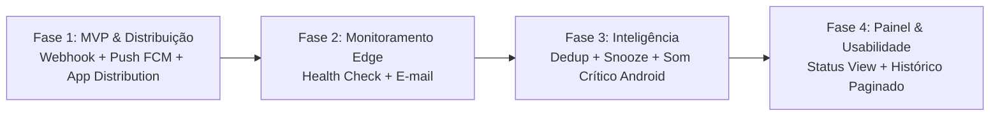

# Sentinel — Roadmap e Gestão de Riscos

Este documento estabelece as fases de entrega do Sentinel, os critérios de pronto (*Definition of Done*) para cada etapa e a matriz de riscos técnicos associados ao projeto, focado exclusivamente no ecossistema Android do proprietário.

*(Nota de escopo: Suporte a iOS e APNs está fora de escopo por ora).*

---

## 1. Visão Geral das Fases de Evolução

---

## 2. Detalhamento das Fases

### Fase 1: MVP e Distribuição Android
*Objetivo:* Estabelecer o fluxo de ponta a ponta: enviar um webhook simples, despachar via FCM e receber no smartphone Android do dono, distribuindo o app via Firebase App Distribution.

- **Escopo:**
  - Criação do Cloudflare Worker básico com endpoint `POST /v1/events`.
  - Configuração do projeto Firebase Cloud Messaging (FCM) gratuito.
  - Implementação da chamada de despacho FCM HTTP v1 dentro do Worker.
  - Criação do app em React Native (Android) para registrar o aparelho, obter o token FCM e salvar no banco D1.
  - Configuração do pipeline de distribuição com **Firebase App Distribution** para disponibilizar versões de teste/release diretamente no celular do dono.
- **Critérios de Pronto (DoD):**
  - [ ] Um comando cURL dispara uma mensagem JSON para o endpoint na Cloudflare e o push chega no celular Android em menos de 3 segundos.
  - [ ] O app React Native registra o token FCM com sucesso no backend ao iniciar.
  - [ ] O aplicativo é compilado e distribuído com sucesso via Firebase App Distribution, sendo instalado pelo app Firebase App Tester no smartphone do dono.

---

### Fase 2: Monitor Externo Ativo & Ingestão de E-mails
*Objetivo:* Eliminar o ponto único de falha adicionando health checks que rodam na edge da Cloudflare e canal para ingestão de e-mails de alerta.

- **Escopo:**
  - Configuração do Cloudflare Cron Trigger (execução a cada 1 minuto).
  - Tabela `services` no Cloudflare D1 contendo URLs de monitoramento das APIs do dono.
  - Lógica de timeout (5s) e verificação de status HTTP 200.
  - Regra de 2 falhas consecutivas antes de emitir alerta de queda para evitar falsos positivos.
  - Auto-recuperação (*auto-resolve*): push automático quando o serviço voltar ao ar com cálculo do tempo fora.
  - Configuração do Cloudflare Email Routing com domínio próprio e Email Worker com parser MIME para processar e-mails de quotas de nuvem e relatórios.
- **Critérios de Pronto (DoD):**
  - [ ] Ao parar intencionalmente um container Docker de uma API de testes, o Sentinel dispara alerta de queda em até 2 minutos.
  - [ ] Ao reativar o container, o Sentinel dispara notificação informando a recuperação e o tempo de downtime.
  - [ ] O envio de um e-mail de teste para `alertas@dominio.com` é processado pelo Worker e gera notificação push no Android com o assunto do e-mail.

---

### Fase 3: Inteligência de Alertas (Deduplicação, Severidade e Snooze)
*Objetivo:* Acabar com a fadiga de alertas e garantir que emergências reais acordem o dono mesmo com o celular Android em modo Não Perturbe.

- **Escopo:**
  - Geração de fingerprint de eventos e controle de janela deslizante (10 minutos) via Cloudflare KV.
  - Agrupamento de incidentes repetidos com contadores de ocorrência (`[x10] Erro de banco de dados`).
  - Configuração de canais de notificação no Android via Notifee:
    - `sentinel_critical`: som alto (`siren.wav`), prioridade máxima (`IMPORTANCE_MAX`) e `bypassDnd: true`.
    - `sentinel_error`: som padrão (`alert.wav`), prioridade alta (`IMPORTANCE_HIGH`).
    - `sentinel_info`: silencioso (`IMPORTANCE_LOW`).
  - Ações interativas na notificação push do Android para silenciar (*Snooze*) o serviço por 15m, 1h ou 4h.
  - Gravação de regras de mute no KV com TTL automático.
- **Critérios de Pronto (DoD):**
  - [ ] Um script que dispara 50 erros idênticos em 10 segundos resulta em apenas 1 alerta sonoro inicial e atualização de contadores sem disparar 50 toques.
  - [ ] Alerta com severidade `CRITICAL` toca som de alarme audível mesmo com o celular Android com volume no mudo / "Não Perturbe" ativado.
  - [ ] Tocar em "Silenciar por 1 hora" na notificação impede novos toques do mesmo serviço durante os próximos 60 minutos.

---

### Fase 4: Painel de Controle, Histórico e Usabilidade
*Objetivo:* Proporcionar uma visão clara e unificada do status operacional das APIs no app Android.

- **Escopo:**
  - Tela principal do app com lista de todos os serviços monitorados e indicador visual de status (*Healthy* verde, *Degraded* amarelo, *Down* vermelho).
  - Tela de histórico com paginação de incidentes passados e detalhes técnicos dos payloads JSON.
  - Capacidade de silenciar serviços manualmente pela interface do app antes de realizar manutenções programadas.
- **Critérios de Pronto (DoD):**
  - [ ] O app exibe o status em tempo real das APIs sem travar a interface.
  - [ ] Detalhes técnicos e metadados de qualquer erro recebido podem ser inspecionados na tela de histórico do app.
  - [ ] Novas versões geradas são publicadas via Firebase App Distribution e notificadas no aparelho.

---

## 3. Matriz de Riscos Técnicos e Mitigações (Android)

| # | Risco Identificado | Probabilidade | Impacto | Estratégia de Mitigação |
| :- | :--- | :---: | :---: | :--- |
| **R1** | **Atraso de push pelo Doze Mode ou otimização de bateria do Android** Fabricantes Android (Samsung, Xiaomi, etc.) encerram processos em background ou atrasam pushes para economizar bateria. | Média | Alto | Utilizar mensagens FCM com `priority: "high"`. O aplicativo deve orientar o dono na primeira execução a desativar a otimização de bateria do sistema para o app Sentinel e conceder permissão de sobreposição de Não Perturbe (`ACCESS_NOTIFICATION_POLICY`). |
| **R2** | **Expiração ou falha de credenciais do Firebase App Distribution** Tokens de CI ou convites expirados impedirem a atualização fácil do aplicativo no celular. | Baixa | Médio | Configurar chave de serviço dedicada (*service account*) no Firebase com papel de *Firebase App Distribution Admin*. Vincular o e-mail do dono como testador permanente no grupo interno. |
| **R3** | **Limites do Free Tier da Cloudflare** Workers possui limite de 100.000 requisições/dia no plano grátis; D1 possui limites diários de leitura/escrita. | Baixa | Médio | Com checagens a cada 1 minuto (1.440 reqs/dia) e uso pessoal de webhooks (algumas centenas/dia), o consumo ficará abaixo de 3% da cota gratuita da Cloudflare. O KV filtra checagens redundantes e reduz acessos ao D1. |
| **R4** | **Parser de e-mails quebrar com formatos MIME complexos** E-mails com múltiplos anexos ou formatos HTML incomuns falharem no Worker. | Média | Baixo | Utilizar biblioteca bem testada no ecossistema Workers (ex.: `postal-mime`), extraindo prioritariamente o campo de texto puro (`text/plain`). Caso não haja, aplicar strip de tags HTML básico no `text/html`. Tratar exceções com fallback para salvar apenas assunto e remetente. |
| **R5** | **Loop infinito de erros esgotando cotas de armazenamento** Uma aplicação quebrando sem parar gerar milhares de eventos em poucos minutos. | Alta | Alto | O motor de deduplicação na edge (KV com janela de 10 min) intercepta o evento logo na entrada. Apenas o primeiro evento cria registro completo e incrementa contadores, descartando escritas redundantes no D1 durante a janela. |
